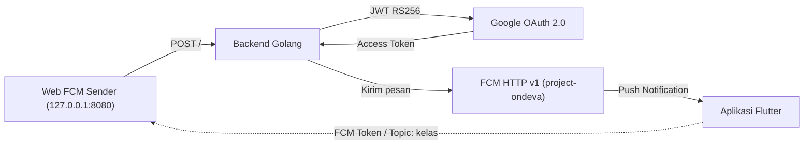

# Aplikasi Firebase Auth & FCM Notification

Aplikasi mobile berbasis Flutter yang menggunakan Firebase Authentication untuk login dan Firebase Cloud Messaging (FCM) untuk push notification, dilengkapi web pengirim notifikasi sederhana menggunakan Golang.

## Identitas Mahasiswa

- **Nama:** Daffa Dermawan
- **NIM:** 1124160177
- **Program Studi:** Teknik Informatika
- **Kelas:** TI24SE2
- **Perguruan Tinggi:** Global Institute

## Fitur Aplikasi

1. **Login & Logout:** Autentikasi akun menggunakan Email dan Password via Firebase Auth.
2. **Dashboard User:** Menampilkan data profil user dan FCM Token yang bisa disalin.
3. **Push Notification (FCM):** Menerima notifikasi saat aplikasi dibuka, di background, maupun ditutup, termasuk broadcast lewat topic `kelas`.
4. **Detail Notifikasi:** Menampilkan judul, isi pesan, dan data tambahan saat notifikasi diklik.
5. **Web FCM Sender (Golang):** Halaman web lokal untuk mengirim notifikasi ke satu device (token) atau semua device (topic).

## Teknologi

- Flutter & Dart
- Firebase Authentication
- Firebase Cloud Messaging (HTTP v1)
- Golang

## Arsitektur Sistem



## Screenshot Aplikasi

### 1. Login & Dashboard User

<!-- Taruh screenshot Login / Dashboard User di sini -->


### 2. Web FCM Sender (Golang)

<!-- Taruh screenshot halaman web FCM Sender di sini -->


### 3. Notifikasi & Detail Notifikasi

<!-- Taruh screenshot notifikasi masuk / halaman detail di sini -->


## Struktur Project

```text
api_dart/
├── lib/
│   ├── main.dart
│   ├── firebase_options.dart
│   ├── pages/
│   │   ├── login_screen.dart
│   │   ├── user_info_screen.dart
│   │   └── notification_detail_screen.dart
│   ├── services/
│   │   └── notification_service.dart
│   └── widgets/
│       └── fcm_token_card.dart
├── notification_sender/
│   └── golang/
│       ├── go.mod
│       ├── main.go
│       └── index.html
└── .github/
    └── workflows/
        └── build-apk.yml
```

## Cara Menjalankan Aplikasi

Pastikan Flutter SDK dan Go sudah terpasang.

### 1. Aplikasi Flutter

1. Clone repository:

```bash
git clone https://github.com/daffadermawan30/api-firebase.git
```

2. Masuk ke folder project:

```bash
cd api-firebase
```

3. Install dependencies:

```bash
flutter pub get
```

4. Jalankan aplikasi:

```bash
flutter run
```

### 2. Backend Golang (FCM Sender)

1. Unduh file service account dari Firebase Console (`Project Settings` → `Service accounts` → `Generate new private key`).
2. Simpan file tersebut dengan nama `service-account.json` di folder `notification_sender/golang/`.
3. Jalankan server:

```bash
cd notification_sender/golang
go run .
```

4. Buka `http://127.0.0.1:8080` di browser.
   - Pilih **Satu device** lalu tempel FCM Token dari aplikasi untuk kirim ke satu HP.
   - Pilih **Topic** lalu isi `kelas` untuk kirim ke semua HP yang subscribe.
   - Jika ingin mengganti port, gunakan environment variable `ADDR` (contoh: `$env:ADDR="127.0.0.1:9090"; go run .`).

## Catatan Keamanan

- File `service-account.json` dan hasil build backend Golang sudah dimasukkan ke `.gitignore` supaya tidak ikut ter-commit ke GitHub.
