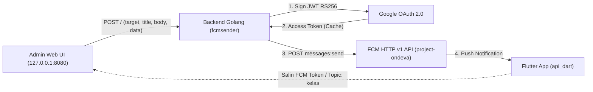

# Aplikasi Firebase Auth & FCM Notification (`api_dart`)

Aplikasi Firebase Auth & FCM Notification merupakan aplikasi mobile berbasis Flutter yang terintegrasi dengan Firebase Authentication dan Firebase Cloud Messaging (HTTP v1) untuk mata kuliah Pemrograman Mobile.

## Identitas Mahasiswa

- **Nama:** Daffa Dermawan
- **NIM:** 1124160177
- **Program Studi:** Teknik Informatika
- **Kelas:** TI24SE2
- **Perguruan Tinggi:** Global Institute

## Fitur Aplikasi

1. **Login Firebase:** Halaman autentikasi login menggunakan Email dan Password melalui Firebase Authentication.
2. **Auth Wrapper:** Deteksi status sesi pengguna secara real-time (`authStateChanges`) untuk mengarahkan ke Dashboard atau Login.
3. **Dashboard User:** Menampilkan foto profil (`photoURL`), UID, nama, email, status verifikasi email, dan waktu terakhir login beserta tombol refresh profil.
4. **FCM Token Card:** Menampilkan FCM Token perangkat dilengkapi tombol salin (*copy to clipboard*).
5. **Push Notification (FCM):** Menerima notifikasi pada kondisi *foreground* (`flutter_local_notifications`), *background*, dan *terminated*, serta otomatis subscribe ke topic `kelas` dengan channel Android `high_importance_channel`.
6. **Detail Notifikasi:** Menampilkan judul, isi pesan, dan seluruh data tambahan (`data` payload) ketika notifikasi diklik.
7. **Logout:** Keluar dari akun Firebase dan kembali ke halaman Login.

## Teknologi

- Flutter & Dart
- Material Design 3
- Firebase Authentication
- Firebase Cloud Messaging (HTTP v1)
- Flutter Local Notifications
- Golang 1.22+ (Standard Library)
- GitHub Actions (Auto-Build Debug APK)

## Arsitektur Sistem



### Alur Pengiriman FCM HTTP v1

- **Target:** Mendukung pengiriman ke satu perangkat (`token` dari `FcmTokenCard`) maupun broadcast ke banyak perangkat (`topic`, misalnya `kelas`).
- **Payload:** Menyusun objek `notification` (`title`, `body`, dan `image` opsional), konfigurasi Android (`priority: "high"`, `channel_id: "high_importance_channel"`), serta data tambahan berformat `key=value` per baris yang ditampilkan pada `NotificationDetailScreen`.

## Struktur Project

```text
api_dart/
├── lib/
│   ├── main.dart
│   ├── firebase_options.dart
│   ├── pages/
│   │   ├── login_screen.dart
│   │   ├── user_info_screen.dart
│   │   └── notification_detail_screen.dart
│   ├── services/
│   │   └── notification_service.dart
│   └── widgets/
│       └── fcm_token_card.dart
├── notification_sender/
│   └── golang/
│       ├── go.mod
│       └── main.go
└── .github/
    └── workflows/
        └── build-apk.yml
```

## Cara Menjalankan Aplikasi

Pastikan **Flutter SDK** dan **Go 1.22+** sudah terpasang.

### 1. Aplikasi Flutter

1. Clone repository:

```bash
git clone https://github.com/daffadermawan30/api-firebase.git
```

2. Masuk ke folder project:

```bash
cd api-firebase
```

3. Install dependencies:

```bash
flutter pub get
```

4. Jalankan aplikasi:

```bash
flutter run
```

### 2. Setup Kredensial Backend Golang (OAuth 2.0)

Backend Golang menggunakan autentikasi **OAuth 2.0 Service Account** (`RS256` JWT) untuk memperoleh *access token* Google secara otomatis dan menyimpannya di cache memori (`sync.Mutex`) hingga 60 detik sebelum kedaluwarsa.

1. Buka **Firebase Console** → pilih project `project-ondeva` → **Project Settings** → **Service accounts** → klik **Generate new private key**.
2. Simpan file hasil unduhan sebagai `service-account.json` di folder `notification_sender/golang/` *(atau di folder induknya `notification_sender/`)*.
3. Untuk menguji pembacaan kredensial dan autentikasi OAuth 2.0:

```bash
cd notification_sender/golang
go run .
```

## Catatan Keamanan

- File `service-account.json` dan binary hasil build backend Golang sudah diproteksi di `.gitignore` agar tidak ikut ter-commit ke repository.
